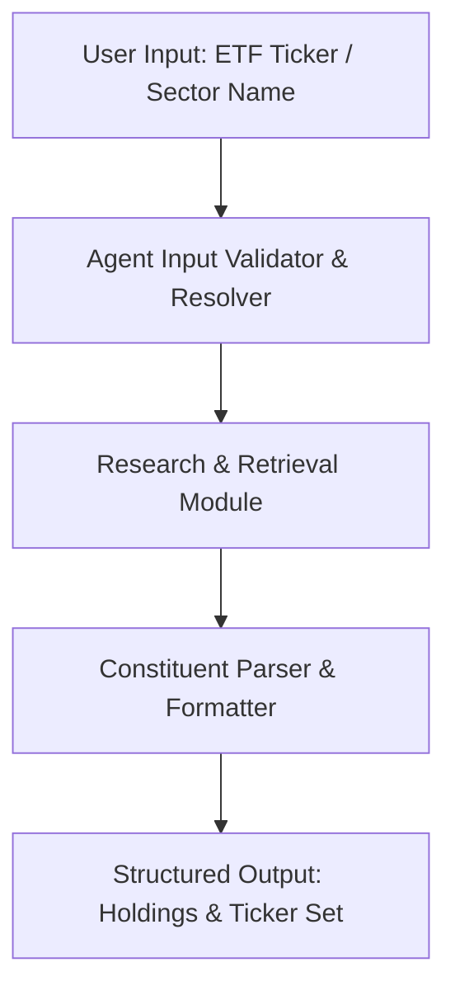

# Specification: Sector Leaders Agent

## 1. Overview
**Sector Leaders** is a Python-based agentic application designed to analyze equity sectors and Sector Exchange Traded Funds (ETFs). The app accepts a sector name or ETF ticker symbol (e.g., `XLF`) from the user, researches the top constituents of that sector or ETF, and extracts a structured list of constituent stock symbols along with their portfolio weights.

---

## 2. Goals & Key Features

- **User Query Flexibility**: Accepts either an ETF ticker symbol (e.g., `XLF`, `XLK`, `XLE`) or a general sector name (e.g., *Financials*, *Technology*, *Energy*).
- **Agentic Research**: Uses an AI agent framework and web search or financial data sources to retrieve current top constituent holdings.
- **Top Holdings Extraction**: Identifies top constituents (configurable top 5 to top 10 holdings), including:
  - Company Name
  - Ticker Symbol
  - Portfolio Weight (%)
- **Formatted Symbol Output**: Generates clean ticker symbol sets formatted for downstream financial analysis, stock screeners, or portfolio modeling (e.g., `XLF: {BRK.B, JPM, V, MA, BAC, GS, WFC, MS, C, SCHW}`).

---

## 3. Workflow & Data Flow



### 3.1 Step-by-Step Execution
1. **Input Collection**: Prompts user for target Sector or ETF symbol.
2. **Entity Resolution**: If a sector name is provided, maps it to representative ETF(s) or sector indices if necessary.
3. **Research & Extraction**: Agent queries real-time web or financial data APIs for top 5 to top 10 holdings of the ETF.
4. **Data Structuring**: Parses search output to extract Ticker Symbols, Company Names, and Weight percentages.
5. **Output Formatting**:
   - Displays detailed ranked list of Top Holdings with weights.
   - Displays formatted set of stock symbols.

---

## 4. Input & Output Specification

### 4.1 Example Input
```text
Target: XLF (Financial Select Sector SPDR Fund)
```

### 4.2 Example Output

#### Top Holdings List
```text
Top 10 Holdings for XLF:
1. Berkshire Hathaway Inc. (BRK.B): ~12.2%
2. JPMorgan Chase & Co. (JPM): ~11.7%
3. Visa Inc. (V): ~8.1%
4. Mastercard Inc. (MA): ~5.9%
5. Bank of America Corp. (BAC): ~4.7%
6. Goldman Sachs Group Inc. (GS): ~3.5%
7. Wells Fargo & Co. (WFC): ~3.2%
8. Morgan Stanley (MS): ~3.1%
9. Citigroup Inc. (C): ~2.9%
10. Charles Schwab Corp. (SCHW): ~2.1%
```

#### Symbol Set Output
```text
XLF {BRK.B, JPM, V, MA, BAC, GS, WFC, MS, C, SCHW}
```

---

## 5. Technical Stack & Architecture

- **Language**: Python 3.10+
- **Agent / LLM Framework**: LangChain, Google GenAI SDK, or custom Agent tools.
- **Financial Data / Search Tools**: Financial APIs (`yfinance`, Alpha Vantage, FMP) or Tavily / Web Search tools.
- **CLI / UI Interface**: Interactive Command Line Interface or simple web/API wrapper.

---

## 6. Error Handling & Edge Cases

- **Invalid Input**: Inform user if symbol/sector cannot be resolved.
- **Symbol Normalization**: Handle stock class formatting variations (e.g., `BRK.B` vs `BRK-B`).
- **Data Freshness**: Indicate approximate weights and dynamic market updates.
